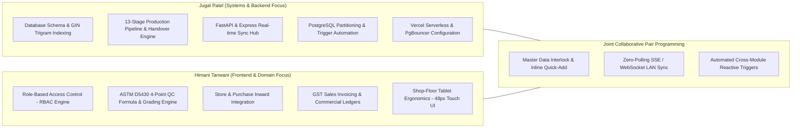

# 👥 WEAVE-TECH ERP: Project Team & Module Ownership

This document details the architectural division of labor and simultaneous collaborative contributions for **WEAVE-TECH ERP** developed by **Jugal Patel** and **Himani Tanwani**.

---

## 👨‍💻👩‍💻 Team Members

| Name | Role / Focus Area | Contact / GitHub |
| :--- | :--- | :--- |
| **Jugal Patel** | Lead Backend & Systems Architect | `jugalpatel204@gmail.com` • [@soulblazei](https://github.com/soulblazei) |
| **Himani Tanwani** | Lead Frontend & Quality Control Architect | `himanitanwani6@gmail.com` • [@himanitanwani](https://github.com/himanitanwani) |

---

## 🏗️ Simultaneous Contribution & Module Division Matrix

Both team members contributed simultaneously across the full stack. The core module ownership is distributed as follows:

### 1. Jugal Patel's Key Contributions
* **PostgreSQL Architecture (`database/migrations/001_core_architecture.sql`):** Designed schema with `pg_trgm` GIN indexes, range partitioning for `stage_quality_audits`, and `trg_grn_finalized` triggers.
* **Shop-Floor Handover Engine (`server/src/controllers/productionController.js`):** Built transactional stage handover logic with mandatory quality gates and rollbacks.
* **Real-time Sync Hub (`server/src/realtime/syncHub.js`):** Implemented zero-polling SSE and WebSocket broadcaster for factory LANs.
* **Python Backend (`backend/`):** Developed FastAPI endpoints and 39 SQLAlchemy data models with SQLite/Supabase hybrid fallback.

### 2. Himani Tanwani's Key Contributions
* **Role-Based Access Control (`frontend/src/config/rbac.js`, `AccessDenied.jsx`):** Engineered 8-role permission matrix, dynamic sidebar filtering, and route protection.
* **ASTM 4-Point QC Engine (`ASTMInspectionCard.jsx`, `FabricQCInspection.jsx`):** Implemented ASTM D5430 defect scoring formula, auto-quarantine routing, and roll grading.
* **Store & Procurement Suite (`StoreModule.jsx`, `PurchaseModule.jsx`):** Developed material requisition, issue logs, gate inward, and GRN inspection notes.
* **Commercial Sales & Finance (`SalesModule.jsx`, `FinanceModule.jsx`):** Built fabric booking queues, taka dispatch packing slips, HSN 5208 GST invoices, and credit/debit notes.
* **Touch-First UI Design System (`tailwind.config.js`):** Designed high-contrast Bright Enterprise Light Theme with 48px touch targets for shop-floor Android tablets.
