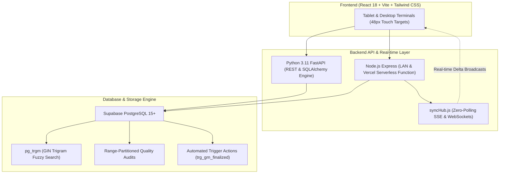

# 🏭 WEAVE-TECH ERP: Enterprise Textile Weaving Plant Operating System

[](https://vercel.com)
[](https://fastapi.tiangolo.com)
[](https://react.dev)
[](https://supabase.com)
[](https://tailwindcss.com)

**WEAVE-TECH ERP** is a modern, enterprise-grade **Manufacturing Execution System (MES)** and **Enterprise Resource Planning (ERP)** software suite designed specifically for on-premise textile weaving plants and grey fabric manufacturing mills.

Developed collaboratively by **Jugal Patel** and **Himani Tanwani**.

---

## 🏛️ System Architecture



---

## 🌟 Key Architectural Innovations

### 1. 13-Stage Sequential Handover & Upstream Quality Rating Gate
Every production lot passes sequentially through 13 discrete shop-floor stages:
1. *Yarn Purchase / Inward*
2. *Winding & Doubling*
3. *Warping & Creeling*
4. *Sizing & Beam Preparation*
5. *Drawing-in & Denting*
6. *Loom Gaiting & Knotting*
7. *Weaving / Loom Shed*
8. *Doffing & Roll Numbering*
9. *Grey Fabric Inspection (ASTM 4-Point)*
10. *Mending & Cropping*
11. *Folding, Rolling & Lapping*
12. *Packaging, Baling & Weighting*
13. *Finished Warehouse / Dispatch*

> **Quality Gate:** Incoming operators must log an upstream 1–5 star rating and defect checklist. Ratings $\le 2$ stars automatically flag the batch as `QUARANTINED`, locking progression until supervisor review.

### 2. ASTM D5430 4-Point Roll Inspection System
Converts manual visual inspections into industry-standard numerical grading:
* Defects $\le 3'' = 1\text{ Point}$
* Defects $3'' - 6'' = 2\text{ Points}$
* Defects $6'' - 9'' = 3\text{ Points}$
* Defects $> 9''\text{ or Holes} = 4\text{ Points}$

$$\text{Points per } 100\text{ m}^2 = \frac{\text{Total Penalty Points} \times 10,000}{\text{Length (m)} \times \text{Width (cm)}}$$

* **Grade A:** $\le 20\text{ pts/100m}^2$ (Export Grade)
* **Grade B:** $21 - 40\text{ pts/100m}^2$ (Commercial Grade)
* **Grade C / Reject:** $> 40\text{ pts/100m}^2$ (Quarantined)

### 3. Role-Based Access Control (RBAC)
Configured with strict station-level permission boundaries across 8 factory roles:
* **Plant Owner / Director (`OWNER`):** Unrestricted plant-wide access and daily executive MIS.
* **Loom Supervisor (`LOOM_SUPERVISOR`):** Production floor, shift logging, and loom RPM/efficiency.
* **QC Inspector (`QC_INSPECTOR`):** ASTM 4-Point roll grading, standards master, and sizing audits.
* **Store Manager (`STORE_MANAGER`):** Store inventory, material requisitions, and purchase inward.
* **Sales Executive (`SALES_EXECUTIVE`):** Booking queues, taka dispatch orders, and GST invoices.
* **CRM Executive (`CRM_EXECUTIVE`):** Customer inquiries, agency leads, and meter forecasts.
* **Finance Accountant (`FINANCE_ACCOUNTANT`):** General ledger, trial balance, credit/debit notes, and GST reports.
* **Payment Officer (`PAYMENT_OFFICER`):** Vendor payment vouchers and buyer collections.

### 4. GIN Trigram Fuzzy Search (`pg_trgm`)
Prevents duplicate master entries (e.g. spelling variations of buyer or mill names) by computing `similarity(name, $1) > 0.2` directly on PostgreSQL GIN indexes, offloading heavy string computation from low-power Android tablets.

### 5. Automated Cross-Module Reactive Triggers
* **GRN Approval:** Auto-credits Store stock balances and marks Purchase Orders as `FULFILLED`.
* **Purchase Return:** Auto-generates vendor `Debit Note` in Finance.
* **Taka Dispatch:** Sets Sales Orders to `DISPATCHED` and pre-populates draft GST Sales Invoices (HSN `5208`, 5% textile tax).
* **Sales Return:** Auto-generates customer `Credit Note` in Finance.

---

## 🚀 Getting Started

### 1. Prerequisites
* **Node.js** v18+ or v20+
* **Python** 3.11+ (optional, for FastAPI engine)
* **Git**

### 2. Clone the Repository
```bash
git clone https://github.com/soulblazei/weavetech-erp.git
cd weavetech-erp
```

### 3. Install & Run (Frontend)
```bash
npm --prefix frontend install --legacy-peer-deps
npm --prefix frontend run dev
```
Open [http://localhost:5173](http://localhost:5173) in your browser.

### 4. Run Backend API
* **Node.js Server:**
  ```bash
  cd server
  npm install
  npm start
  ```
* **Python FastAPI Server (Alternative):**
  ```bash
  cd backend
  pip install -r requirements.txt
  python -m uvicorn main:app --host 0.0.0.0 --port 8000 --reload
  ```

---

## 👥 Contributors & Authorship
See [`CONTRIBUTORS.md`](./CONTRIBUTORS.md) for detailed module ownership and collaborative development details.
* **Jugal Patel** ([@soulblazei](https://github.com/soulblazei)) - Lead Backend & Systems Architect
* **Himani Tanwani** ([@himanitanwani](https://github.com/himanitanwani)) - Lead Frontend & QC Domain Architect
